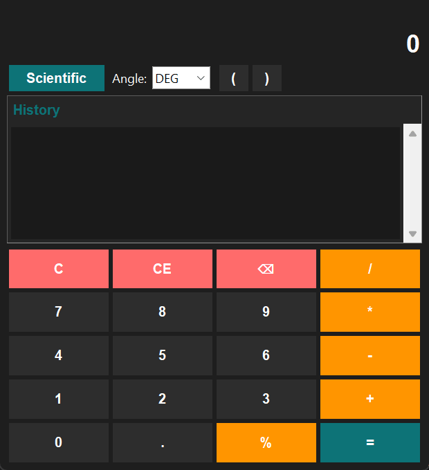
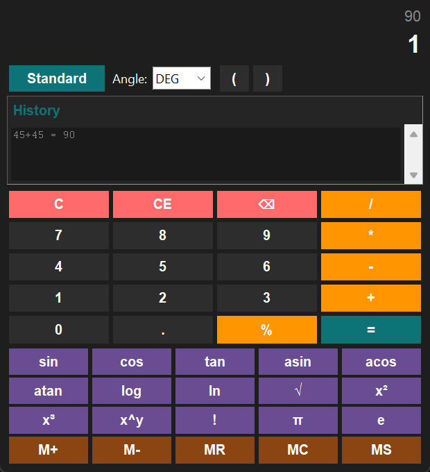

# Simple Calculator

A Python calculator with a Tkinter desktop GUI, scientific functions, memory,
history, and a command-line mode.

[](https://github.com/ShahabAhmed01/simple-calculator/actions/workflows/ci.yml)
[](https://github.com/ShahabAhmed01/simple-calculator/releases)
[](https://www.python.org/)
[](LICENSE)
[](#requirements)

<p align="center">
  
</p>

## Quick start

**Requires:** Python 3.10 or newer with Tkinter. There are no third-party
runtime dependencies.

```bash
git clone https://github.com/ShahabAhmed01/simple-calculator.git
cd simple-calculator
python calculator_advanced.py
```

The desktop application opens with standard arithmetic buttons. Click
**Scientific** for trigonometry, logarithms, powers, constants, and memory
functions.

On Windows, if `python` opens the Microsoft Store, use the Python launcher
instead:

```powershell
py calculator_advanced.py
```

### Command-line mode

The original command-line calculator is still included:

```bash
python calculator.py
```

### Convenience launcher

`run.py` provides a menu and shortcuts for both modes:

```bash
python run.py          # interactive menu
python run.py gui      # desktop application
python run.py cli      # command-line calculator
python run.py test     # test suite
python run.py check    # verify Python and Tkinter
```

## Features

### Standard mode

- Addition, subtraction, multiplication, and division
- Decimal numbers and parentheses
- Percentage button (`50` → `0.5`)
- Backspace, clear entry (CE), and clear all (C)
- Live result preview while typing
- History of the last 10 calculations

### Scientific mode

- Trigonometry: `sin`, `cos`, `tan`, `asin`, `acos`, `atan`
- Logarithms: `log` (base 10) and `ln` (natural)
- Roots and powers: `√`, `x²`, `x³`, `x^y`
- Factorial (`0` through `170`)
- Constants: `π` and `e`
- Degree and radian angle modes

### Memory and keyboard

- `M+`, `M-`, `MR`, `MC`, and `MS`
- Mouse and keyboard input
- No network access, accounts, telemetry, or external services

## Usage

### Scientific mode

1. Click **Scientific** to show the extra buttons.
2. Choose **DEG** or **RAD** in the angle selector.
3. Enter a value and click a function.

For example, with **DEG** selected, enter `90` and click `sin` to get `1`.
For a power, enter the base, click `x^y`, enter the exponent, and press
`Enter` or `=`.

### Keyboard shortcuts

| Key | Action |
| --- | --- |
| `0`–`9`, `.` | Enter numbers |
| `+`, `-`, `*`, `/`, `^` | Operators |
| `(` `)` | Parentheses |
| `%` | Convert the current value to a percentage |
| `Enter` | Calculate |
| `Backspace` | Delete the last character |
| `Escape` | Clear everything |

### Examples

These are outputs from the test suite and the engine:

```text
(20 + 5) * 2 = 50
2^10 = 1024
5! (factorial button) = 120
sin(90°) = 1
log(100) = 2
ln(e) = 1
```

<p align="center">
  
</p>

## Requirements

- Python 3.10 or newer
- Tkinter, which is included with the official python.org installers

Tkinter is usually present on Windows and macOS. On Linux, install the
distribution package if it is missing:

| Distribution | Command |
| --- | --- |
| Ubuntu / Debian | `sudo apt-get install python3-tk` |
| Fedora | `sudo dnf install python3-tkinter` |
| Arch Linux | `sudo pacman -S tk` |

Check the installation with:

```bash
python run.py check
```

## Development

The runtime has no third-party dependencies. Create an isolated environment
and install the development tooling:

```bash
python -m venv .venv

# Windows
.venv\Scripts\activate

# macOS / Linux
source .venv/bin/activate

python -m pip install -r requirements-dev.txt
```

### Tests

```bash
python -m unittest discover -s tests -t . -v
```

The original entry point still works:

```bash
python test_calculator.py
```

### Linting

```bash
python -m ruff check .
```

The GUI tests are skipped automatically when Tkinter or a display is not
available. CI runs the engine and CLI tests on Windows, macOS, and Linux, plus
a dedicated GUI test job on Linux under Xvfb. The GUI has also been manually
exercised on Windows.

## Project structure

```text
simple-calculator/
├── calculator_advanced.py   # Tkinter desktop application
├── calculator_engine.py     # Safe expression evaluator and math functions
├── calculator.py            # Command-line calculator
├── run.py                   # Menu and convenience commands
├── test_calculator.py       # Backward-compatible test runner
├── tests/                   # unittest suite
├── tools/                   # Optional screenshot and social-preview tools
├── docs/                    # Screenshots and social preview
├── .github/workflows/       # CI
├── requirements.txt         # No runtime dependencies
├── requirements-dev.txt     # Ruff
├── pyproject.toml           # Ruff configuration
└── LICENSE
```

## How it works

`calculator_engine.py` parses expressions with Python's `ast` module and walks
a whitelist of numeric nodes. It does not use `eval`. The evaluator supports
`+`, `-`, `*`, `/`, `%`, `^`, parentheses, `π`, and `e`, with limits on
expression length, exponents, and factorial size.

`calculator_advanced.py` is a Tkinter interface around that engine. It keeps
history in memory, tracks a separate memory register, and converts between
degrees and radians when needed.

## Limitations

- This is a desktop application; there is no web or mobile version.
- History is kept in memory and is lost when the application closes.
- Scientific buttons operate on the current value. The typed expression
  syntax supports arithmetic operators and parentheses, not function names
  such as `sin(90)`.
- Results must fit in a Python float, so very large powers and results are
  rejected with an error message.
- Factorial is limited to `170` and the expression length to 200 characters.
- There is no graphing, unit conversion, or persistent storage.
- The GUI is tested on Linux in CI and has been exercised on Windows; macOS
  runs the engine tests but not the GUI test.

## Contributing

Contributions are welcome. Read [CONTRIBUTING.md](CONTRIBUTING.md) for the
development setup, testing commands, and pull-request expectations.

- Report a bug or request a feature with the issue templates.
- Report security concerns privately as described in [SECURITY.md](SECURITY.md).
- Keep runtime dependencies at zero unless there is a strong reason to add one.
- Add tests for behavior changes.

This is a small educational project, so response times may vary.

## License

This project is available under the [MIT License](LICENSE).
